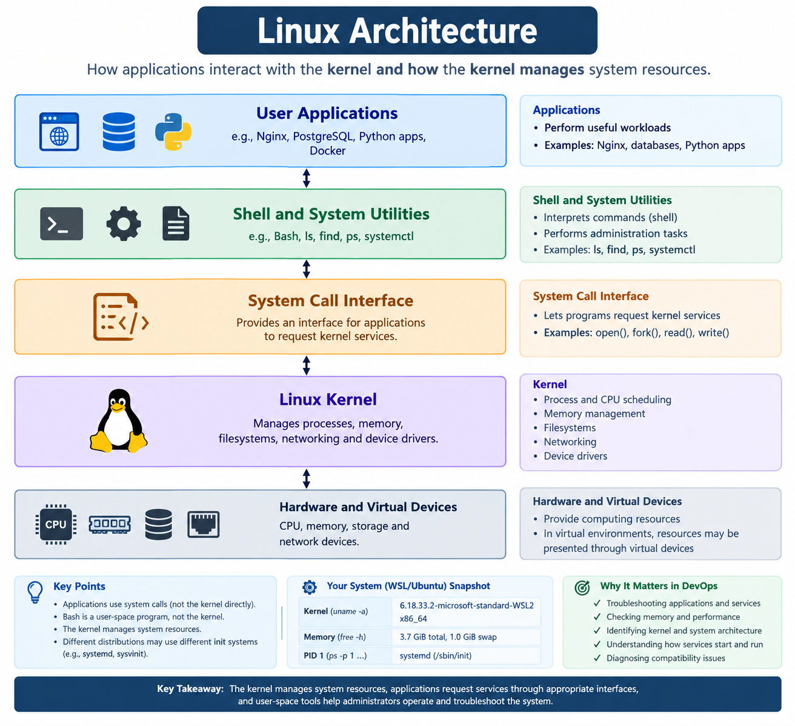

# Architecture of Linux


## 1. Overview

Linux architecture describes how applications interact with the kernel and how the kernel manages system resources.

The main components include applications, system utilities, the system call interface, the kernel, and hardware or virtual devices.

## 2. Main Components

### Applications

Applications perform tasks such as serving websites, running databases, and executing Python programs.

Examples: Nginx, PostgreSQL, and Python applications.

### Shell and System Utilities

The shell accepts and interprets commands. System utilities perform tasks such as file management, process inspection, and troubleshooting.

Examples: Bash, `ls`, `find`, and `ps`.

### System Call Interface

Applications use system calls to request services from the kernel, such as opening files or creating processes.

### Linux Kernel

The kernel manages:

- Processes and CPU scheduling
- Memory
- Filesystems
- Networking
- Device drivers

### Hardware and Virtual Devices

These provide resources such as CPU, memory, storage, and network interfaces. In virtual environments, these resources may be presented through virtual devices.

## 3. Inspect the Kernel

Command:

```bash
uname -a
```

Displays the kernel name, hostname, kernel release, and architecture.

My WSL environment reported:

```text
Linux ThalluriGowtham 6.18.33.2-microsoft-standard-WSL2 #1 SMP PREEMPT_DYNAMIC Thu Jun 18 21:54:43 UTC 2026 x86_64 GNU/Linux
```

The `x86_64` value identifies the 64-bit x86 architecture.

## 4. Inspect Memory and Swap

Command:

```bash
free -h
```

Displays memory and swap usage in human-readable units.

The `available` field estimates how much memory can be made available to new applications. The `buff/cache` field includes memory used for caching, some of which can be reclaimed when needed.

My output showed 3.7 GiB of total memory and 1.0 GiB of swap in the Linux environment.

## 5. Inspect Process ID 1

Command:

```bash
ps -p 1 -o pid,comm,args
```

Displays the process ID, command name, and command arguments for PID 1.

My environment reported:

```text
PID COMMAND         COMMAND
1   systemd         /sbin/init
```

PID 1 has a special role in Linux userspace. In this environment, `systemd` is running as the init system.

Systemd can manage services and coordinate system startup. Other Linux environments may use a different init system.

## 6. Why This Matters in DevOps

Understanding Linux architecture helps when:

- Investigating application and process failures.
- Checking available memory during performance problems.
- Identifying the kernel and system architecture.
- Understanding how services are started and managed.
- Diagnosing compatibility issues in virtual machines and containers.

## Key Takeaway

The kernel manages system resources, applications request services through appropriate interfaces, and user-space tools help administrators operate and troubleshoot the system.

Commands such as `uname`, `free`, and `ps` provide practical ways to inspect these components.

## Learning Status

**Status:** Foundation-level Linux architecture concepts and system inspection practised.